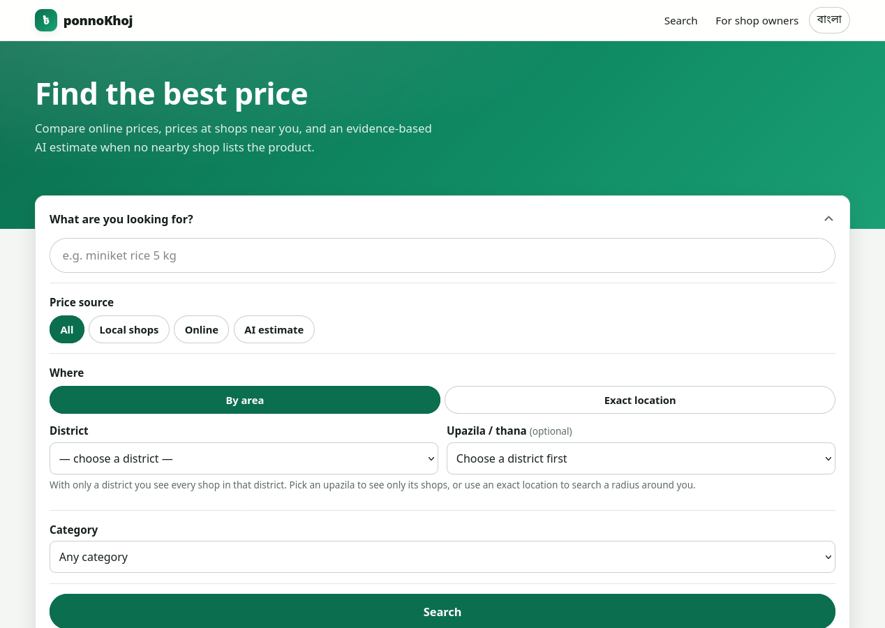
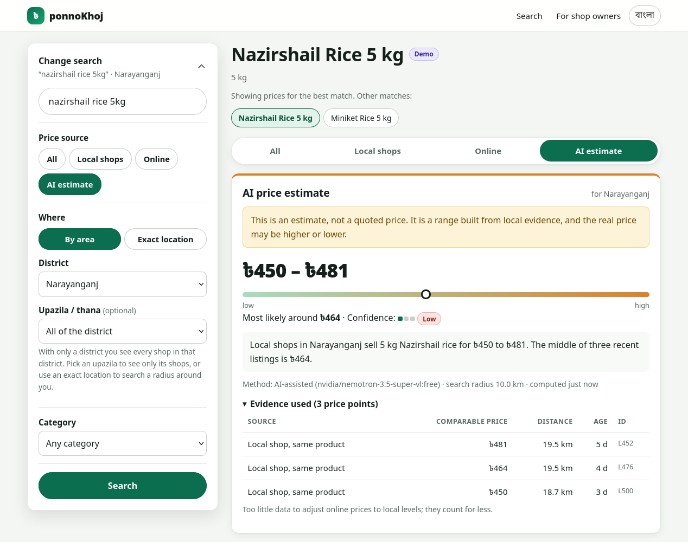
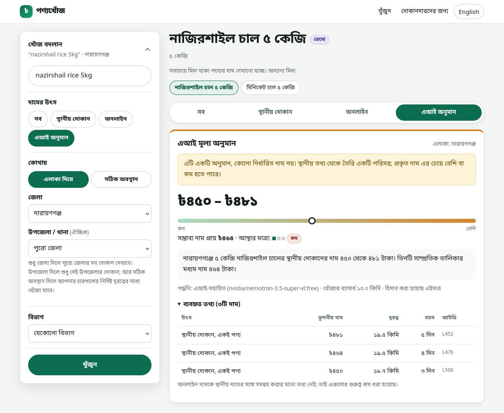
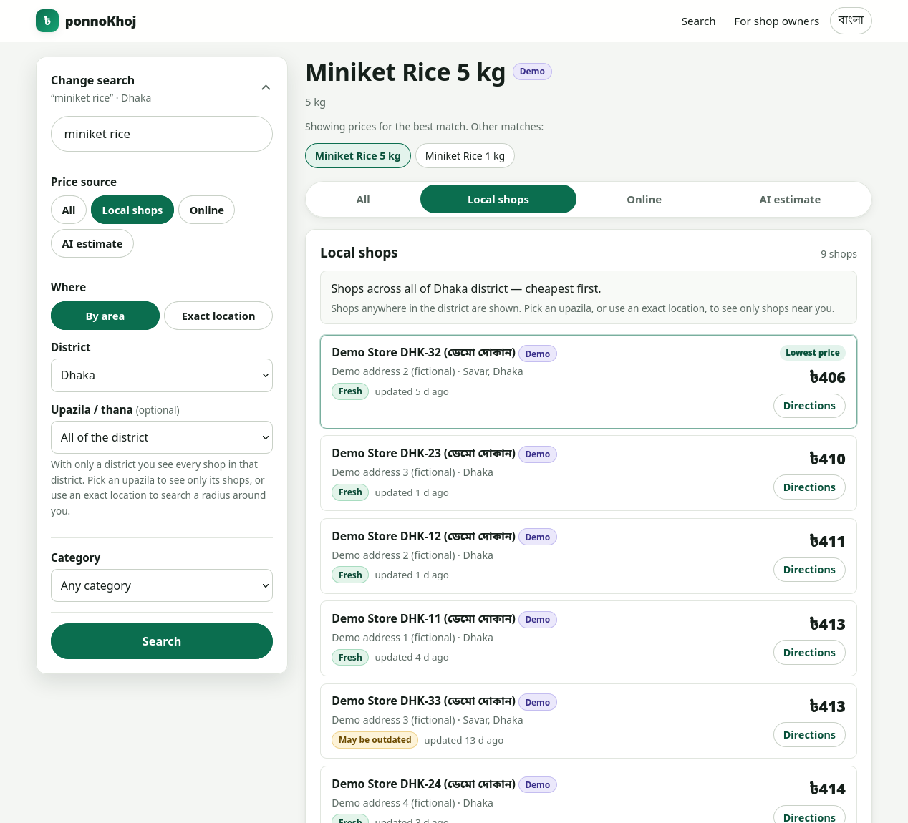
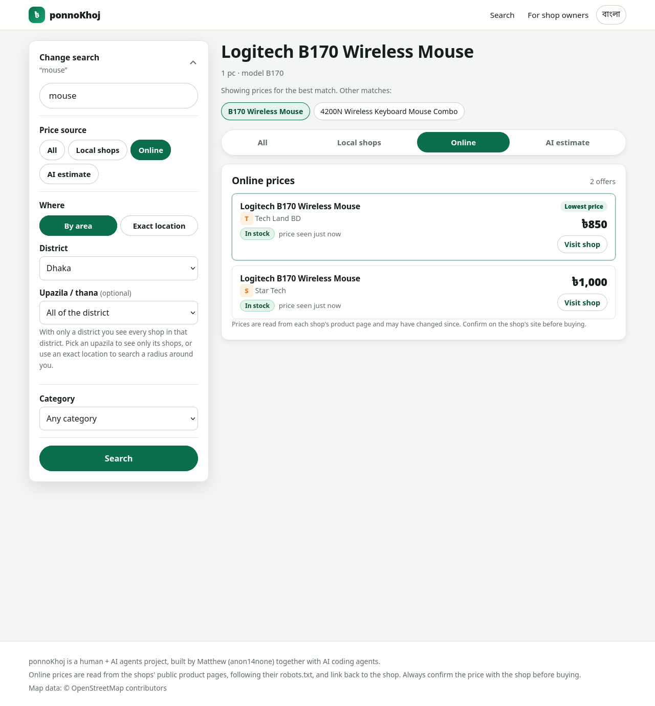
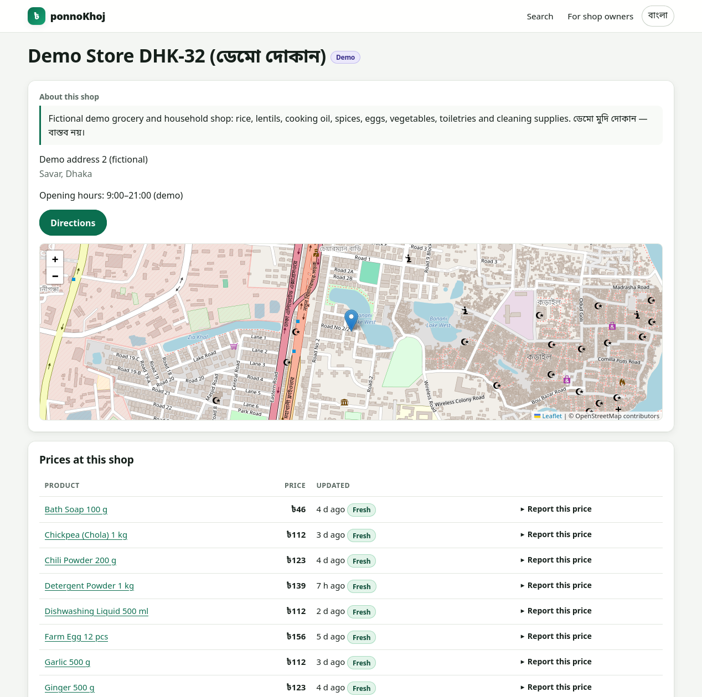
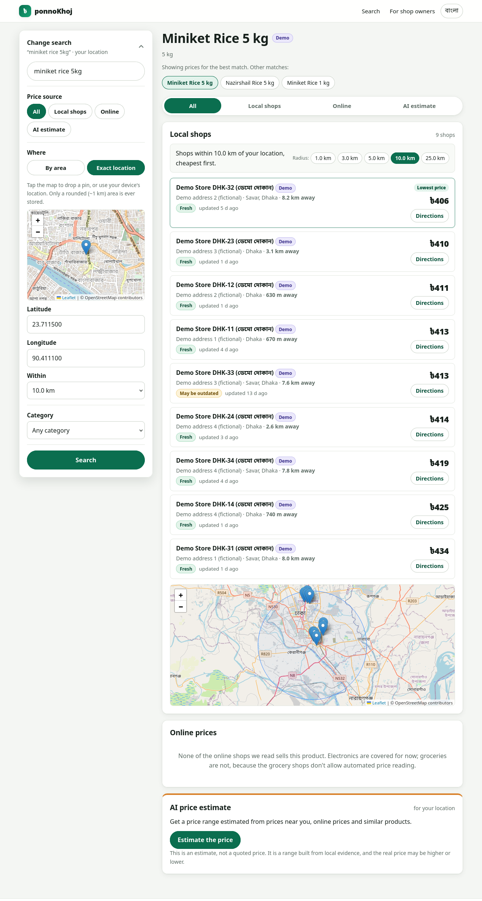
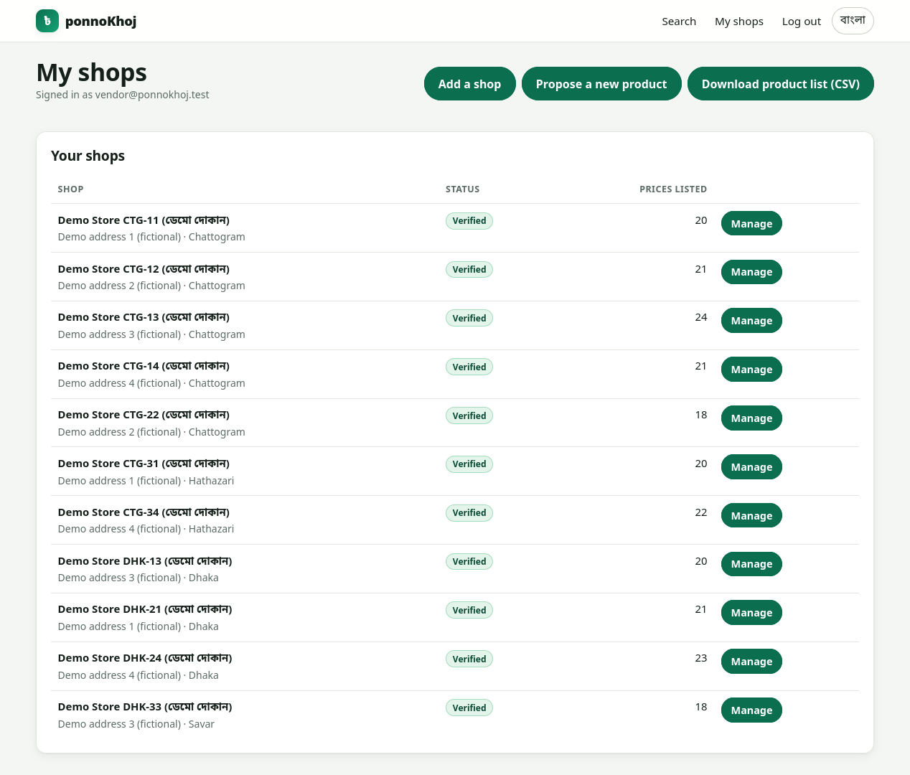
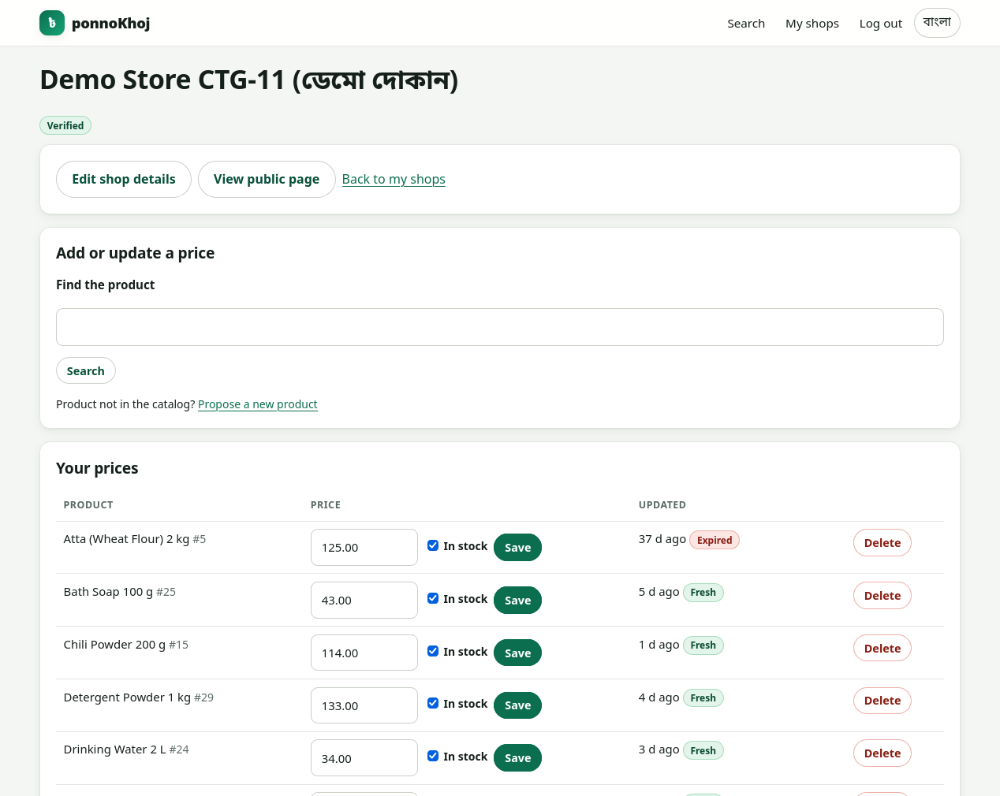
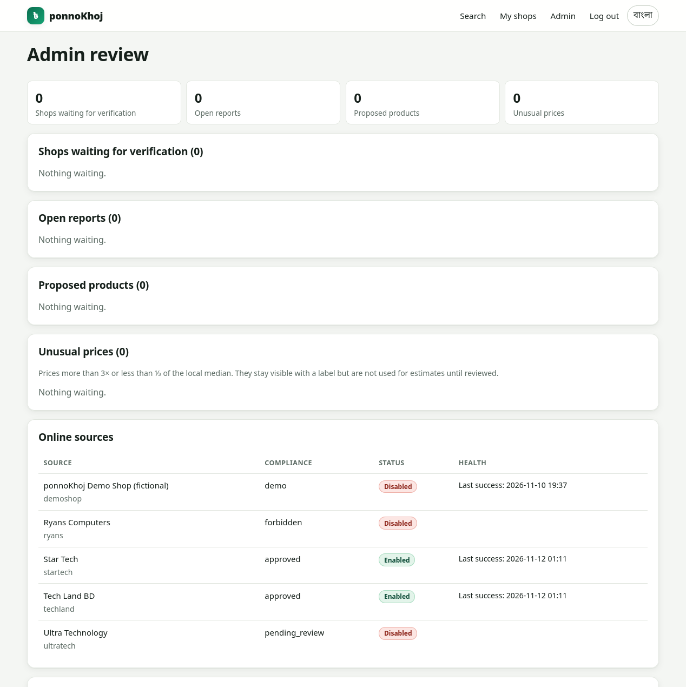

# ponnoKhoj (পণ্যখোঁজ)

[](https://github.com/shtmthw/ponnoKhoj/actions/workflows/ci.yml)
[](https://hub.docker.com/r/matthew552/ponnokhoj)
[](LICENSE)

Find the best price for a product (*ponno*) in Bangladesh, from online shops **and** from local offline shops near you.

> **Human + AI agents project.** ponnoKhoj is built by **Matthew (anon14none)**, the human developer, together with AI coding
> agents. Matthew sets the direction, designs the system and reviews the work; the agents help write, test and ship it.



## What it does

Online prices are often inflated, and most local shops don't sell online at all. ponnoKhoj shows you both:

| Mode | Where the price comes from |
|---|---|
| **Local shops** | Prices shop owners list themselves (no online store needed), with address, map and directions |
| **Online** | Public product pages of online shops ([Star Tech](https://www.startech.com.bd), [Tech Land BD](https://www.techlandbd.com)) |
| **AI estimate** | When nobody nearby lists a price: a price **range** built from real evidence (nearby, online and past prices) |

Search by district, by upazila, or by an exact location with a radius. The site works in Bangla and English, and without
JavaScript.

📱 **Fully mobile friendly.** The site is built for phones first, and every page works on a small screen. The screenshots below
are desktop-sized only so they're easier to read here.

AI estimates are ranges, not quotes, and the real price may be higher or lower. If there isn't enough evidence, you get no
estimate rather than a guess. See [`docs/estimation.md`](docs/estimation.md).

## Screenshots

**AI price estimate.** No shop in Narayanganj lists this rice, so the AI builds a price range from nearby evidence. It shows
its confidence, a plain-language explanation, the model used and every piece of evidence it relied on.



| The same estimate in Bangla | Local shops, cheapest first |
|---|---|
|  |  |

| Online prices from real shops | Shop page with map and price list |
|---|---|
|  |  |

**Every source at once, by exact location.** Drop a pin, pick a radius, and see nearby shops (with distances and a map), online
prices and the AI estimate together.



| Shop owner: my shops | Shop owner: managing prices |
|---|---|
|  |  |

**Admin review:** shop verification, reports, proposed products, unusual prices and the health of each online source.



## Run it

**Docker Compose** (quickest; offline demo data):

```sh
make dev-up      # http://localhost:8080
make dev-down
```

**Local Kubernetes** with kind (the full stack):

```sh
make kind-up     # http://localhost:8088
make deploy-dev  # redeploy after changes
make kind-down
```

Demo logins are `admin@ponnokhoj.test` and `vendor@ponnokhoj.test`; their passwords are generated into `deploy/compose/.env`
or `deploy/k8s/overlays/dev/.env.dev`. Demo shops are fictional and labelled "Demo".

**Docker image:** `docker.io/matthew552/ponnokhoj`. It needs PostgreSQL with PostGIS and pg_trgm; run `migrate up` and `seed`
once, then `serve` and `worker`. All settings are environment variables: see [`docs/configuration.md`](docs/configuration.md).

## Tech

One Go binary (`serve`, `worker`, `migrate`, `seed`, …) on PostgreSQL 17 + PostGIS. Pages are server-rendered with
`html/template` and HTMX; maps use Leaflet with OpenStreetMap. The only JavaScript is vendored HTMX and Leaflet plus one small
map script (`internal/web/static/app.js`). No Node build step.

## Docs

- [Architecture](docs/architecture.md) · [JSON API](docs/api.md) · [Configuration](docs/configuration.md) · [Runbook](docs/runbook.md)
- [Online sources and their terms](docs/sources.md) · [Area data](docs/data-sources.md) · [Decisions (ADRs)](docs/adr/)
- Contributing: `make ci` runs every check locally. Security issues: [`SECURITY.md`](SECURITY.md)

## For shop owners

You don't need an online store. Sign up under **For shop owners**, add your shop with a pin on the map, and list your prices one
by one or by CSV upload. Your shop appears in search once an admin verifies it.

## License

[MIT](LICENSE) © Matthew (anon14none). HTMX, Leaflet, the area dataset and OpenStreetMap data keep their own licenses.
Map data © OpenStreetMap contributors (ODbL).
